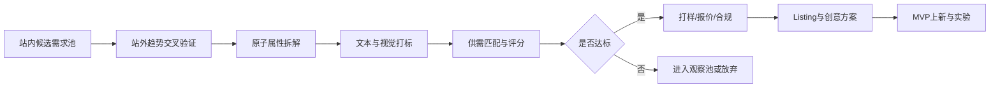
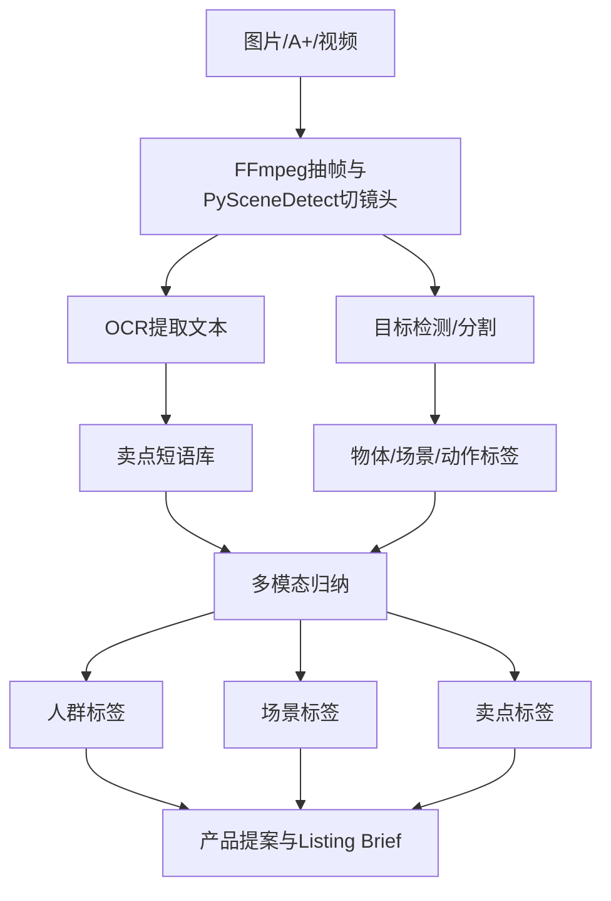
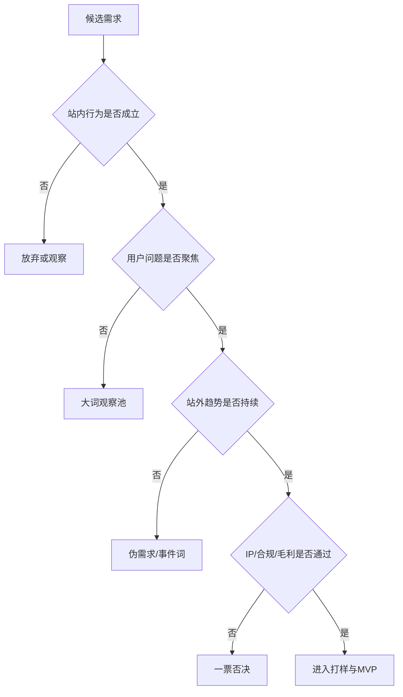
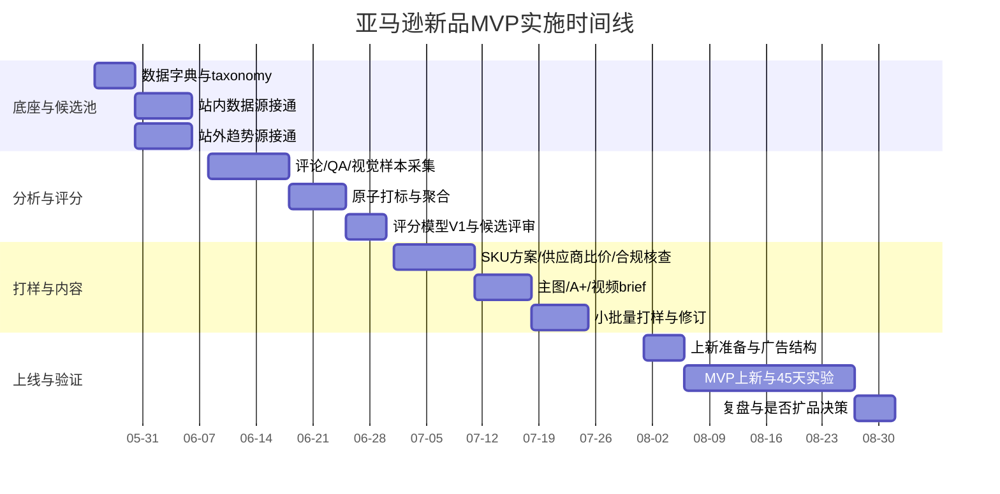

# 亚马逊开品新品思路研究报告

**执行摘要**

这份报告给出的不是“再罗列一遍选品动作”，而是一套适合 **中小团队、2–5 人、3 个月内交付 MVP** 的新品方法论：先用 **亚马逊站内真实购物行为数据** 找到“客户已经在找、已经在买、但现有供给还没完全满足”的细分需求，再用 **站外趋势与内容证据** 验证需求是否可持续，随后把产品拆成 **原子级属性**，通过文本、图片、A+、视频帧、评论、QA 做结构化打标，最后用 **供需匹配 + 运营难度 + 季节性 + IP/合规风险** 的评分模型做 Go/No-Go 决策。之所以推荐这条路线，是因为 Amazon 官方已提供 Product Opportunity Explorer、Brand Analytics 的 Search Query Performance / Search Catalog Performance、Customer Reviews、A+ Content、Catalog Items API、Product Type Definitions API 等强信号工具；Google Trends、TikTok、YouTube、Pinterest、Reddit、抖音/微博开放能力则可以补齐“需求起点、传播势能、创意语言、场景表达”的外部证据链。citeturn7search0turn2search7turn1search7turn6search0turn4search0turn15search0turn16search0turn0search0turn8search4turn9search0turn13search1turn8search0turn28view0turn11search0

本报告的核心判断是：**新品不是先想“卖什么”，而是先证明“有人持续要什么”，再设计“我能不能用更好的属性组合满足它”。** 在执行上，建议把 12 周拆成四段：前 2 周搭底座与候选池；第 3–6 周完成站内外采集、原子打标和市场筛选；第 7–9 周做样品、报价、合规与主图/A+方案；第 10–12 周只保留 1 个 SKU 进入 MVP 上新与验证实验。对没有大数据团队的卖家，最小可行版本不需要重型大模型平台：**对象存储 + PostgreSQL JSONB + DuckDB/Parquet + 向量检索 + 轻量视觉/文本流水线** 就够了。citeturn22search2turn21search2turn21search3turn34search0

## 总体方案与决策框架

亚马逊官方工具已经把新品决策最关键的几类信号公开出来了：Product Opportunity Explorer 能看搜索、购买、评论、价格、供给饱和度、缺货、Prime 供给、广告渗透、季节性等；Brand Analytics 的 Search Query Performance / Search Catalog Performance 能看到 **impressions、clicks、cart adds、purchases** 这样的购物漏斗指标，并支持品牌/ASIN 维度分析；Customer Reviews 和 Customer Review Insights 能把评论主题聚合出来；Catalog Items API 能拉到 **attributes、browse classifications、dimensions、images、sales rankings、relationships**；Product Type Definitions API 则给出某个 product type 的 JSON schema 和字段要求。也就是说，**站内需求、竞争、属性、内容、风险** 已经可以被统一建模，而不必只凭前台经验和工具商“估算流量”。citeturn7search0turn2search7turn1search7turn6search0turn6search8turn15search0turn16search0

你要做的不是追求“高需求低竞争”这种过度粗糙的口号，而是把判断收敛成五个连续问题：**有没有稳定需求、需求是不是具体可拆的、供给是否存在缺口、缺口能不能转成可交付的属性方案、这件事值不值得你们团队在 3 个月内做完。** 下面这个流程建议直接作为团队共识流程。其节点设计依据 Amazon 官方需求/漏斗工具、Google Trends 的归一化趋势与 related searches 机制，以及 TikTok/YouTube/Pinterest/Reddit 等公开趋势或 API 能力。citeturn7search0turn2search7turn0search0turn0search7turn8search4turn12search7turn9search0turn13search1turn8search0



建议把决策门槛拆成两层。第一层是 **真需求门**：必须同时满足站内需求证据、站外趋势证据、用户问题证据中的至少两类。第二层是 **商业可做门**：需要通过毛利、运营复杂度、知识产权/合规风险、季节性波动和内容差异化能力的复核。这样做的好处是，团队不会因为某个词在社媒上火了就误判，也不会因为某个亚马逊类目看起来卖得快、但本质上难做、侵权高、差评集中而误入坑。citeturn0search0turn0search7turn7search1turn6search8turn24search2turn29search0turn23search0

## 选品思路与贡献点

选品建议同时走两条路：**站内路径** 负责验证“成交需求”，**站外路径** 负责判断“需求来源、增长方向、传播语言和场景表达”。站内尽量优先 Amazon 官方数据，其次再补前台采样；站外优先平台官方趋势/开放接口，其次再补人工观察和线下采样。Amazon 官方明确说明 Product Opportunity Explorer 用于分析客户搜索、购买、评论、价格与供给缺口；Brand Analytics 则把 query 到 click、cart、purchase 的漏斗打通；Google Trends 提供匿名、分类、聚合后的搜索样本，并将结果标准化到 0–100，同时支持 top / rising related searches；TikTok Creative Center 提供区域性的 hashtag、songs、creators、videos 趋势；Pinterest Trends 提供最长两年的搜索、收藏和购物趋势；YouTube、TikTok、Reddit、抖音开放能力都可以取到一定范围的内容与互动数据。citeturn7search0turn2search7turn0search0turn0search7turn8search4turn13search1turn9search0turn12search7turn8search0turn28view0

下表把这两条路径压缩成可执行的工作表。**表中的阈值是建议值，不是平台规则**；第一轮建议先选 3 个类目回测，再针对你实际做的类目校准。数据源能力和指标口径依据官方文档整理。citeturn7search0turn2search7turn15search0turn16search0turn0search0turn8search4turn9search0turn13search1turn8search0turn28view0

| 路径 | 数据源 | 采集方法 | 关键指标 | 真需求判定规则 | 伪需求警报 | 优先级 | 单次耗时 | 交付格式 |
|---|---|---|---|---|---|---|---|---|
| 站内 | Product Opportunity Explorer | Seller Central 导出或人工录表 | 搜索量、年增长、价格带、评论、缺货率、Prime 占比、广告渗透、季节性 | 12 周趋势向上或平稳；缺货率/Prime 空缺/广告低渗透至少命中 1 项；评论痛点聚焦 | 只有短期峰值、季节性过强、搜索高但供给已极度饱和 | P0 | 1–2 天/类目 | CSV + 类目卡 |
| 站内 | Search Query Performance / Search Catalog Performance | Brand Analytics 导出 | impressions、clicks、cart adds、purchases、CTR、ATC rate、CVR | 核心 query CTR 与 CVR 不低于类目中位数；至少 3 个 query 能形成同一需求簇 | 只有曝光没转化；转化只集中于品牌词 | P0 | 1 天/类目 | 漏斗表 + query map |
| 站内 | 亚马逊搜索前台 | 手工采样 + 自动截图/录屏 | 联想词、结果页结构、Sponsored 位密度、卖点重复度 | 联想词稳定出现，且搜索页前 24 个结果卖点高度重复，说明“可被切入” | 联想词高度事件化、节庆化、名人化 | P1 | 0.5 天/词包 | 截图墙 + 关键词簇 |
| 站内 | 类目榜 / Movers & Shakers | 前台采样 | 头部 SKU 结构、价格带、变化榜 | 头部 SKU 结构松散、属性分化大，适合找新组合 | 头部高度品牌化且创新空间小 | P1 | 0.5–1 天/类目 | 榜单观察表 |
| 站内 | 前台参数 + Catalog Items API | API + 页面解析 | attributes、dimensions、images、sales rankings、relationships | 可把产品拆成一组可比较的原子字段，且存在明显缺失/非标准化字段 | 参数混乱到无法对齐、类目 schema 变化频繁 | P0 | 1 天/类目 | 字段字典 |
| 站内 | QA | 前台采样 | 问题主题频次、答非所问率、使用场景 | 同一问题在多个 ASIN 重复出现，且是“购买前犹豫点” | 只问物流/售后，不是产品问题 | P1 | 0.5–1 天/20 ASIN | QA 主题表 |
| 站内 | Reviews / Customer Review Insights | 官方工具 + 前台评论 | 星级、负面主题、verified purchase 特征、近期差评 | 同一负面主题在 Top20 ASIN 评论中占比 ≥8% 且连续出现 | 差评高度分散，无清晰痛点 | P0 | 1–2 天/类目 | 评论主题矩阵 |
| 站内 | 红人/产品视频 | 前台 + 视频抓帧 | 演示场景、用户口语卖点、功能误解点 | 视频里反复演示同一动作/痛点，说明卖点容易被看懂 | 只能靠滤镜和情绪带货，功能表达弱 | P1 | 1 天/20 视频 | 帧集 + 视频脚本表 |
| 站内 | A+ 页面 | 前台采样 | 对比表、模块结构、品牌叙事、场景图 | 竞品 A+ 里没有回答用户核心疑虑，存在内容缺口 | 头部都已把核心痛点讲透 | P1 | 0.5–1 天/10 ASIN | A+ 拆解卡 |
| 站内 | V3 属性 / Product Type Definitions | 官方 schema | 必填属性、枚举值、变体主题、合规字段 | 能找到“高频搜索但当前 schema 未被充分表达”的属性组合 | 类目受限严重、必填与合规要求复杂 | P0 | 0.5 天/product type | JSON schema 摘要 |
| 站外 | Google Trends | 网页导出 | 0–100 热度、地域分布、相关词 Top/Rising | 12 个月指数稳定上行，或 90 天增幅 >25%，且 rising 词不是新闻事件词 | “Breakout” 只由单一事件驱动 | P0 | 0.5 天/词簇 | 趋势图 |
| 站外 | TikTok Creative Center / Research API | 官方趋势页或 API | hashtag、video、view_count、like/comment/share | 至少 3 个内容母题反复出现且能映射到产品场景 | 只火内容形式，不火产品问题 | P1 | 1 天/赛道 | 话题簇图 |
| 站外 | YouTube Data API | search + videos/channels | view、like、comment、发布时间 | 长尾教程/评测持续增长，说明需求偏“解决问题”而非一过性 | 只有开箱流量，没有后续问题讨论 | P1 | 1 天/赛道 | 视频主题表 |
| 站外 | Pinterest Trends | 官方趋势工具 | 搜索、save、shopping trends、seasonality | 家居、美妆、DIY、礼品类如果 Pin saves 与 shopping trends 同升，说明兼具灵感与购买意图 | 只有 aesthetic，无购买动作 | P2 | 0.5 天/赛道 | 趋势笔记 |
| 站外 | Reddit API | subreddit / post / comment | 高频抱怨、替代方案、DIY hack | 用户在讨论“怎么解决”而不是“哪个好看” | 纯娱乐梗、无购买线索 | P2 | 1 天/赛道 | 痛点语料表 |
| 站外 | 抖音/微博开放能力 | 官方开放平台 + 人工观察 | 视频/粉丝/互动、热点词、话题迁移 | 国内热点话术能迁移到海外亚马逊卖点表达 | 热点只适合内容分发，不适合货品 | P2 | 1 天/赛道 | 中文语料补充包 |
| 站外 | 线下渠道 | 门店走访 + Census 零售数据 + recall 数据 | 上新频率、陈列密度、价签、退换/召回风险 | 线下陈列增加且线上趋势同步，说明不是纯线上泡沫 | 大量召回或监管风险类目 | P1 | 2–3 天/城市 | 门店巡检表 |

从“贡献点”视角，新品不要追求“大创新”，而要追求 **被需求证据支持的小创新**。最值得优先做的贡献点通常只有四类：**功能补丁型**（解决差评集中痛点）、**场景强化型**（把竞品没讲清的场景讲清）、**属性重组型**（把高频属性以新组合交付）、**内容表达型**（把卖点变成更高理解度的主图/A+/视频语言）。Amazon 官方已经给了足够多的证据接口去做这件事：评论主题、A+ 对比、视频演示、query 漏斗、niche 供需结构，本质上都在指向用户没被满足的“具体点”，而不是抽象地说“这个类目还不错”。citeturn7search1turn6search8turn3search3turn4search0turn2search7

## 技术路线与数据架构

技术路线建议从“产品”反过来做成“数据对象”。也就是，把每个候选新品拆成 **原子参数层、内容层、行为层、风险层** 四张表；再把它们汇总成一个 **机会对象 Opportunity**。Amazon 的 Catalog Items API 本身就已经把 attributes、dimensions、browse classifications、images、sales rankings、relationships 这种结构化信息暴露出来；Product Type Definitions API 则给出 product type 所需字段和 JSON schema。值得注意的是，Amazon 官方文档已说明旧的 XML 和 flat file listings feeds 自 2025 年 7 月 31 日起不再支持，MVP 阶段就不应该再围绕老式平铺表做核心设计，而应该直接围绕 **JSON_LISTINGS_FEED + product type schema** 设计字段体系。citeturn15search0turn16search0turn16search4

下面这张字段表，建议直接作为你的数据字典初版。字段名称可以英文化，业务说明中文化。

| 字段层 | 字段示例 | 示例格式 | 用途 | 优先级 |
|---|---|---|---|---|
| 基础标识 | marketplace, asin, parent_asin, brand, product_type, browse_node | `US,B0XXXX,parent,color_and_size,Home` | 对齐类目、变体、品牌 | P0 |
| 商品属性 | material, size, capacity, power, fit_type, age_range, use_scene | `silicone,30x20cm,500ml,USB-C,desk,adult,travel` | 原子拆解与属性重组 | P0 |
| 商业价格 | list_price, deal_price, coupon, pack_count | `29.99,24.99,10%,2-pack` | 价格带与 bundle 判断 | P0 |
| 内容质量 | image_count, main_image_style, video_count, aplus_modules | `7,white_bg+usage,1,comparison+story` | Listing 完整度 | P1 |
| 漏斗行为 | impressions, clicks, cart_adds, purchases, ctr, cvr | `105000,4200,370,185,4.0%,4.4%` | 真需求与转化判断 | P0 |
| 评价反馈 | rating, review_count, neg_topic_top3, qa_topic_top3 | `4.2,1360,leak/slip/noisy,size?` | 痛点挖掘 | P0 |
| 视觉标签 | object_tags, scene_tags, text_ocr, claim_tags | `bottle/lid/strap,car/gym,leakproof BPA-free,portability` | 主图/A+/视频提炼 | P1 |
| 供应格局 | top10_review_median, ad_density, oos_rate, prime_ratio | `280,0.42,6.1%,73%` | 供给缺口 | P0 |
| 风险 | tm_hit, design_patent_flag, recall_flag, restricted_flag | `0/1/0/0` | IP/合规风险 | P0 |
| 决策输出 | opportunity_score, decision, owner, next_action | `78,Go,PM01,sample` | 项目推进 | P0 |

视觉分析流程建议不要一开始就上重型端到端“全能模型”，而是拆成四步：**抓帧、OCR、目标/场景识别、语义归纳**。FFmpeg 适合抽帧，PySceneDetect 适合按镜头切分；PaddleOCR 在多语言 OCR 与文档解析上很成熟，Google Cloud Vision / Azure Vision / Rekognition 适合快速验证 OCR 或标签能力；YOLO 适合封闭物体清单检测，Grounding DINO 适合开放词汇目标检测，SAM 适合从图里切出模块区域；CLIP 适合做图文相似度、卖点聚类与零样本标签。视频有语音时再用 Whisper 做多语言转写。这里的原则是：**先把可解释的中间结果拿出来，再让多模态模型归纳卖点。** 这样你在做主图 brief、A+ 框架和差异化提案时，团队能看到“证据链”，而不是只有一个黑箱结论。citeturn20search0turn20search2turn18search1turn18search2turn35search4turn32search11turn30search0turn33search0turn33academia36turn17academia49turn17academia48turn19search0



一个适合中小团队的工具组合如下。**左边优先开源，右边优先商用 PoC。**

| 任务 | 开源首选 | 商用首选 | 适用说明 | 优先级 |
|---|---|---|---|---|
| 视频切镜头/抽帧 | FFmpeg + PySceneDetect | – | 视频帧证据提取基础层 | P0 |
| OCR / 文档解析 | PaddleOCR | Google Cloud Vision / Azure Vision OCR | 主图文字、A+ 文案、包装信息抽取 | P0 |
| 标签识别 | YOLO | Rekognition / Cloud Vision labels | 固定对象清单与场景粗分类 | P1 |
| 开放词目标检测 | Grounding DINO | – | “带杯套”“吸管口”“防滑底”等开放属性识别 | P1 |
| 图像分割 | SAM | – | 切出模块、视角、结构部件 | P1 |
| 语音转写 | Whisper | 各云语音服务 | 视频口播与用户语言提取 | P1 |
| 图文对齐/语义检索 | CLIP | – | 图文相似、卖点归纳、聚类 | P1 |
| 向量检索 | Faiss / pgvector | Milvus | 多模态标签召回与主题聚类 | P2 |

数据清洗与存储建议采用 **Bronze / Silver / Gold** 三层。Bronze 存原始页面快照、图片、视频帧、导出 CSV；Silver 存清洗后的字段表和统一 taxonomy；Gold 存机会评分、候选清单与 Brief。中小团队不建议一上来就搞复杂湖仓：对象文件用 Parquet，分析用 DuckDB，业务主表用 PostgreSQL JSONB，向量检索先用 pgvector 或 Faiss，数据量再大才上 Milvus。PostgreSQL 官方文档明确建议大多数 JSON 场景优先用 `jsonb`；DuckDB 官方强调 Parquet 读写高效并支持列式压缩与 predicate pushdown；Faiss/pgvector/Milvus 都适合做向量相似检索，但以 MVP 复杂度来说，**pgvector 或 Faiss 足够了**。citeturn22search2turn21search2turn34search0turn21search3turn21search0

## 数据打标、聚合与评分模型

打标不要直接从“卖点”开始，而要从 **原子标签** 开始。建议至少打九类：**人群、场景、问题、功能、结构、材质、尺寸/适配、情绪/审美、风险**。例如针对一个收纳类产品，“浴室小户型、怕潮、想壁挂、无打孔、白色极简、承重担忧、安装麻烦、需适配瓷砖/玻璃” 都应该被拆成独立标签，而不是只写一个“浴室收纳”。这样做的原因，是评论、QA、A+、视频帧和 query 常常描述的是同一需求的不同面：Google Trends 和 TikTok/YouTube 可能讲“为什么火”；Amazon query 讲“客户怎么搜”；评论和 QA 讲“哪里不满”；A+ 和视频讲“竞品怎么讲”；最终你需要的是把这些语言都映射回同一个标签系统。citeturn0search0turn0search7turn12search7turn9search0turn7search1turn6search8turn4search0turn3search3

聚合算法建议分三层走。第一层是 **规则聚合**：把明确字段直接入库，比如颜色、容量、材质、价格带。第二层是 **主题聚合**：对评论、QA、视频转写、A+ 文案做 embedding + clustering，输出高频主题簇。第三层是 **供需匹配**：把需求向量 `D` 和供给向量 `S` 放到同一标签空间中，计算“高需求、低满足”的差值。一个简单而可落地的做法是：

- `DemandScore = AmazonDemand + ExternalTrend + ProblemIntensity`
- `SupplyScore = ListingMaturity + ReviewMoat + AdCrowding + BrandConcentration`
- `GapScore = DemandScore - SupplyScore`

其中 `AmazonDemand` 主要来自 POE 与 query 漏斗，`ExternalTrend` 来自 Google Trends / TikTok / YouTube / Pinterest / Reddit，`ProblemIntensity` 来自评论和 QA；`ListingMaturity` 基于头部内容完整度，`ReviewMoat` 看头部评论量中位数，`AdCrowding` 看搜索页 Sponsored 密度，`BrandConcentration` 看头部品牌集中度。这个模型最重要的不是“数学多高级”，而是 **每个分量都能回溯到证据**。citeturn7search0turn2search7turn0search0turn12search7turn9search0turn13search1turn8search0turn6search8

真伪需求判定建议用“**三证合一**”规则：  
第一，**站内行为证据**：核心 query 的 CTR、ATC rate、CVR 至少有一个不差于类目中位数；或者 POE 显示 niche 搜索和购买在增长。第二，**用户问题证据**：Top20 ASIN 中至少 3 个 ASIN 出现同一痛点，且该痛点在负面评论主题中占比建议 ≥8%。第三，**站外持续性证据**：Google Trends 过去 12 个月不是单点爆发；TikTok/YouTube/Pinterest/Reddit 至少两处讨论的是同一使用场景或问题，而不是无关话题共振。只要三项里满足两项，就进候选；三项都满足，进入打样池。若只满足站外热度、不满足站内行为，通常判为伪需求；若只满足站内搜索、不满足用户问题与站外持续性，通常判为“泛需求大词”，不适合中小团队第一批 SKU。citeturn7search0turn2search7turn0search0turn0search7turn12search7turn9search0turn13search1turn8search0turn6search8

在评分模型上，我建议把最终机会分数做成 100 分制，权重如下。**以下权重是建议值，适合 3 个月 MVP，不是固定真理。**

| 评分维度 | 权重建议 | 判断口径 | 建议阈值 |
|---|---:|---|---|
| 真实需求强度 | 30 | 站内漏斗 + POE + 用户问题 | ≥22 为强 |
| 供给缺口 | 20 | 内容缺口、缺货、Prime 空缺、广告低渗透 | ≥14 为强 |
| 可差异化程度 | 15 | 能否用属性组合/主图/A+/视频讲出清晰差异 | ≥10 为强 |
| 毛利与价格带 | 15 | 预估 landed cost、佣金、FBA、退货后毛利 | ≥10 为强 |
| 运营难度 | 10 | 供应链、变体复杂度、补货压力、售后 | ≤4 为优 |
| 季节性稳定度 | 5 | 12 个月波动与断崖风险 | ≥3 为可做 |
| IP / 合规风险 | 5 | 商标、专利、召回、受限品 | ≥4 为低风险 |

建议阈值：**总分 ≥75 进入打样与报价；65–74 进入观察池；<65 放弃。** 但有两个一票否决项：**IP/合规红线** 与 **毛利不成立**。USPTO 已上线新商标搜索系统；Amazon Brand Registry 可以用 Report a Violation 处理版权/商标/专利问题；CPSC、FDA、EU Safety Gate 都提供可检索的公开召回/警示数据，因此 IP/合规不应该等产品做出来才查，而应该在候选阶段就前置筛掉。citeturn23search0turn24search2turn23search3turn29search0turn29search1turn29search2

关于虚假评论与异常需求，建议额外加一个 **ReviewRiskFlag**。Amazon 的官方资料说明星级并不是简单平均，而会考虑评论的新近性和 verified purchase 等因素；研究也显示，假评论购买行为在产品—评论者网络中具有可识别的聚簇结构。对中小团队的可执行做法是不用追求学术级网络建模，而是上线以下几个廉价规则：**7/30/90 天评论突增、五星占比异常、同日评论文本高度模板化、低分评论集中指向同一结构问题、变体评论被错误嫁接、类目内 rating 明显高但 CVR 并不匹配**。只要命中两项，先把该关键词或竞品从“需求证据”里降权。citeturn6search8turn25academia58



## 输出模板与交付物

真正能落地的团队，最后交付的不是“几十页灵感截图”，而是三类文档：**市场洞察、消费者洞察、产品成功方案**。这三类文档必须统一到同一个 SKU 决策表上，否则前面做的数据与后面的开发/设计/运营就会断层。下面给你一套可以直接复制到飞书、Notion、Markdown 或 PPT 的模板。Amazon 官方已经给出不少内容设计与转化提效依据，比如主图规范、建议提供 6 张图片、A+ 内容可以提升转化、产品视频能提升页面销售；这些都应该回写到最终的创意 brief 里，而不是单独当“美工要求”。citeturn5search8turn5search11turn4search0turn3search3

### 市场洞察模板

| 模块 | 必填内容 | 输出格式 | 判读重点 |
|---|---|---|---|
| 类目定义 | marketplace、browse node、核心关键词簇 | 表格 | 不做大类，要做细分 |
| 需求规模 | POE / query 漏斗 / Trends 指标 | 折线图 + 表格 | 看趋势，不只看单点 |
| 竞争格局 | Top20 ASIN、品牌集中度、评论量中位数、Sponsored 密度 | 气泡图 | 找“可讲差异”的空间 |
| 供给缺口 | 缺货、Prime 空缺、内容缺口、参数缺口 | 热力表 | 找你能补上的坑 |
| 风险摘要 | 商标/专利/受限品/召回 | 风险卡 | 一票否决项前置 |

### 消费者洞察模板

| 模块 | 必填内容 | 输出格式 | 判读重点 |
|---|---|---|---|
| 目标人群 | 年龄/身份/场景/预算/痛点 | Persona 表 | 不超过 2 个主 Persona |
| 搜索语言 | query、联想词、站外热门话术 | 词云 + 词簇表 | 把“人话”映射到 listing 语言 |
| 购买犹豫点 | QA 高频问题、评论负面主题 | 二维表 | 直接决定主图与 bullet |
| 使用场景 | 视频帧场景、A+ 场景、社媒场景 | 场景板 | 看竞品没讲透的场景 |
| 成功标准 | 用户真正想得到的结果 | 一句话 value prop | 必须可验证 |

### 产品成功方案模板

| 模块 | 需要输出的具体内容 | 建议格式 |
|---|---|---|
| SKU 定义 | 核心属性、差异化点、版本策略、变体策略 | PRD 表 |
| 定价 | 目标售价、底价、促销价、首月 coupon | 价格梯度表 |
| Listing 结构 | Title、5 bullet、A+ 结构、FAQ、Search terms | 文案 brief |
| 主图建议 | 主图主题、第二图对比、第三图场景、第四图尺寸、第五图结构、视频脚本钩子 | 创意分镜表 |
| KPI | 曝光、CTR、CVR、首月评价数、ACOS/TACOS、断货率 | KPI 看板 |
| 推广渠道 | PPC、达人、站外引流、测评/种草、邮件/私域 | 预算表 |
| 决策里程碑 | 何时补单、何时扩变体、何时砍掉 | 里程碑表 |

如果你需要一个更具体的 listing 结构，下面这套结构适合大多数中客单、可解释型新品：

| 部位 | 目标 | 建议写法 |
|---|---|---|
| Title | 把“使用场景 + 核心差异 + 关键属性”写清 | 品类词 + 场景词 + 关键参数 + 差异属性 |
| Bullet 1 | 直接打痛点 | “为谁解决什么问题” |
| Bullet 2 | 讲结构/功能 | “为什么比常规方案更稳/更省/更安全” |
| Bullet 3 | 讲适配/尺寸 | “适合哪些人/哪些空间/哪些设备” |
| Bullet 4 | 讲材质/耐用/安全 | “材质、耐久、清洁、认证” |
| Bullet 5 | 讲购买风险缓解 | “包装、售后、使用提示” |
| A+ | 讲“前后对比 + 场景 + 结构拆解 + 对比表” | 先问题，后方案，再参数，再 trust |
| 视频 | 15–30 秒先演示结果，再展示细节 | 先钩子，后动作，最后 CTA |

主图与 A+ 的建议需要跟 Amazon 内容规则对齐。Amazon 的官方说明要求主图白底、产品占比足够高、图像分辨率达到可缩放要求，并建议详情页至少提供多张图片；A+ 可以使用增强图片、对比表、视频等模块；产品视频在详情页的表现已被官方公开强调。你完全可以把“竞品没讲清楚的痛点”直接翻译成第 2 图和 A+ 第一屏。citeturn5search8turn5search11turn4search0turn3search3

下面给一个 **CSV 样例**，可直接作为机会池底表：

```csv
marketplace,keyword_cluster,opportunity_id,need_score,supply_gap,ip_risk,ops_difficulty,decision,hero_painpoint,hero_attribute,target_price
US,under sink organizer,O-2026-001,82,18,1,3,GO,"small cabinet clutter","sliding + narrow width + rust proof",29.99
US,travel coffee mug,O-2026-002,68,9,2,4,WATCH,"leak in bag","lock lid + cupholder fit",24.99
US,pet hair remover,O-2026-003,59,6,3,2,NO_GO,"works on sofa but not car seat","multi-surface compatibility",19.99
```

推广预算如果未指定，我建议以 **“单 SKU 美国站首发”** 做样例预算，而不是给一个空泛的全年预算。建议按 **样品与检测 15% / 首批货与包装 45% / PPC 25% / 内容制作 10% / 预备金 5%** 来切。若团队资金克制，第一阶段只做 **200–500 件小批量**，广告预算控制在首 45 天 **US$1,500–3,000**，配合 Vine 与少量内容合作做证据式验证，而不是一开始就备太深库存。Amazon Vine 官方页面写明单个产品最高可获得 30 条 Vine 评论，并强调其价值在于获取高质量、可操作的产品反馈。citeturn6search2

## 优先级与实施计划

对于 2–5 人团队，最怕的是“什么都想做，最后什么都没闭环”。因此我建议把任务严格分成 **P0、P1、P2**。P0 是 3 个月 MVP 必须完成的；P1 是增强项；P2 是只有在前面跑通后才做的扩展项。

| 优先级 | 任务 | 负责人建议 | 时间估算 | 交付物 |
|---|---|---|---|---|
| P0 | 数据字典与 schema 设计 | 数据/产品 | 3–5 天 | 字段字典、taxonomy |
| P0 | 站内官方数据采集 | 运营/分析 | 1–2 周 | POE、BA 漏斗表 |
| P0 | 评论/QA/参数清洗 | 分析/数据 | 1 周 | 主题矩阵、标签表 |
| P0 | 评分模型 V1 | 产品/分析 | 3–4 天 | 机会池总表 |
| P0 | 1 个 SKU 方案与报价 | 产品/采购 | 1–2 周 | SKU brief、报价单 |
| P0 | 主图/A+/视频 brief | 设计/运营 | 1 周 | 创意 brief |
| P0 | MVP 上新与验证实验 | 运营 | 2–3 周 | 上线日报、实验报告 |
| P1 | 站外 API 自动化 | 数据/算法 | 1–2 周 | 定时任务、趋势报表 |
| P1 | 图像/视频自动打标 | 算法/数据 | 1–2 周 | 视觉标签库 |
| P1 | Dashboard | 数据 | 3–5 天 | 机会看板 |
| P2 | 多市场扩展 | 运营/产品 | 2–4 周 | 市场复制包 |
| P2 | 多 SKU 组合推荐 | 算法 | 2–3 周 | 组合建议器 |

人员配置最简可以是 **3 人**：  
一人负责 **产品/类目研究**，一人负责 **数据与自动化**，一人负责 **运营与内容**。如果有 4–5 人，建议再补一个 **采购/供应链** 和一个 **设计/视频**。不要在 MVP 阶段专门配“全职算法工程师”去追求炫技；前 6 周真正决定胜率的是 **问题定义、字段统一、评分纪律**，不是模型参数。citeturn15search0turn16search0turn7search0turn2search7

下面是一条适合现在就开跑的 12 周时间线。日期以 **2026-05-25** 开始计算，仅作项目管理样例。



MVP 的关键不是“把一堆类目看完”，而是要设计 **最少实验** 来快速证伪。建议至少做四个实验：

| 实验 | 核心假设 | 做法 | 判定阈值 | 结论用途 |
|---|---|---|---|---|
| 关键词共振实验 | 我定义的痛点词真的有人搜/点 | 站内 query + Trends + 社媒话题对照 | 至少 2 个来源同向增长 | 是否保留需求簇 |
| 价格带实验 | 我的价格带能承接需求 | 三档价格模拟毛利 + 小流量广告测试 CTR/CVR | 中位价档 CTR 不差，CVR 可接受 | 定价策略 |
| 创意表达实验 | 我的主图/卖点能否被看懂 | 2–3 套主图/标题 A/B，或站外落地页快速测 | CTR 提升 ≥15% | 主图与标题定稿 |
| 小批量上新实验 | 产品本身能站住 | 200–500 件小批量 + Vine + 精准 PPC | 4 周内评分 ≥4.2，CVR 达标 | 是否补货与扩 SKU |

如果品牌已具备 Brand Registry，A+、视频、Customer Reviews、Brand Analytics 等工具都值得尽早接入；如果没有，MVP 仍然可以跑，但你的站内证据会少一截，此时就更要把 **前台可采集信号、线下观察、站外趋势与评论主题** 做得更扎实。Brand Registry 本身就是 Amazon 面向品牌保护和品牌成长推出的工具集合。citeturn24search0turn24search2turn6search0turn4search0

## 开放问题与适用边界

这份报告给的是 **通用型方法论**，不是针对某个具体类目的现成结论。因此有三类事情，在你正式开跑前仍然要做一次小范围校准。

第一，**类目阈值要校准**。例如“评论量中位数多少算护城河”“广告密度多少算太卷”，在家居、宠物、3C 配件、母婴、服饰并不一样。报告里给的是适合中小团队的首轮建议值，不是各类目通用真值。这个问题不能靠继续读资料解决，必须拿你即将进入的 3 个候选类目做回测。citeturn7search0turn2search7

第二，**前台采集要遵守平台规则**。Amazon、抖音、微博、TikTok、YouTube、Reddit 各自都有自己的开放能力与授权边界；能走官方导出、官方 API、官方后台，就不要用不稳定的灰色抓取。尤其是 Amazon listing 侧字段设计，推荐直接围绕 Product Type Definitions 与 JSON listings schema，不要围绕已经退役的旧平铺 feed。citeturn16search0turn16search4turn12search0turn9search0turn8search0turn28view0turn11search0


第三，**商标、专利、召回、受限品一定要前置检查**。很多“看起来好卖”的产品，真正卡死团队的并不是流量，而是合规与侵权。USPTO、新的 Amazon Brand Registry 工具、CPSC/FDA/EU Safety Gate 这类公开与官方入口，可以让你在做样品前就排掉一批风险。对 3 个月 MVP 来说，这一步的价值通常高于再额外多看 100 个竞品。citeturn23search0turn24search2turn23search3turn29search0turn29search1turn29search2

如果只保留一句话作为最终执行原则，

我建议是：**先用站内行为证明存在真实需求，再用站外趋势证明需求可持续，再把需求翻译成可上架、可拍图、可投放、可交付的属性组合。** 这样做，3 个月内做出一个靠谱的新品 MVP，是现实可行的。